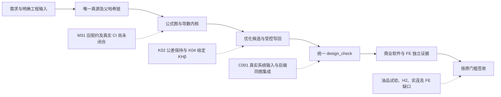

# v0.16 宏观架构与里程碑复核（2026-10-31）

**结论：本轮关闭了可复现的计算/导数/接口子缺口，没有证据支持把 M32–M40 中任何一个整体标为已关闭。最值得优先完成的整体里程碑是 M32。**

目前的架构已经具备唯一真源文档、可追溯求解与修订链、统一核算入口，以及保存原生文件的外部校准路径。瓶颈已经从“再多写一些公式”转为三件事：旧契约是否真正经过统一内核、当前评价器能否准确判断新候选、系统子模块是否由同一份真实输入闭环。

## 原门槛与当前判断

依据 `docs/顶层设计.html` 第15节；`00-里程碑进度.md` / `milestones.py` 的数量是包内统计，不是独立工程通过率。本轮不通过修改分母或降低阈值制造关闭。

| 里程碑 | 原包计数 | 本轮核验与真正阻断 |
|---|---:|---|
| M32 内核统一 | 3/5 | 新内核、量纲等路径已有测试；仍缺旧 M31 契约经新内核适配器回归的完整映射，以及 CI 守门真实执行记录。原脚本只发现 tests/，不能代替 archive/m31 的旧契约。 |
| M33 零手填系数 | 0/4，4 partial | 商业对拍数量不能替代消除保持系数。HB→HV、fsh0 定义、严格几何门和 C001 差异说明仍有原始待决项。 |
| M34 真源与白盒优化 | 2/4 | 原包把梯度门无条件记 done，但 K02/K04 实际 self_check 为 inconsistent。此次已修复六个实际点的值/导数语义并保留前向值；H2 强度层/评估次数门未闭合。Code 真实连接成功，模型403导致三项业务调用未发生，不能关闭客户端门。K02 外部预测差异仍需校准。 |
| M35 对标与制造 | 1/2 | 制造图需要外部工艺人员实际审阅，不能由软件复算或本轮AI审查代替。 |
| M36 系统层 | 0/3，1 partial | 多个标准模块的独立功能与外部系数证据明显增加；C001 同图齿轮/轴/轴承/键仍被真实输入及后端集成阻断，系统优化全枚举和三旗舰回归未完成。 |
| M37 FEA | 0/4 | 现有L0/L1不能当L2/L3，模块B与规定的FE/ISO门及最终闭环仍缺。 |
| M38 产品化 | 0/4，2 partial | 本轮修复了真实Windows UTF8通信问题，但工程师金标、多模型业务评测、独立新机接入仍无完整验收。 |
| M39 全失效模式 | 0/3，1 partial | Cf0 对拍解释了 K04 差异；并未补齐专用油品试验数据、热平衡、规定三目标与公差可行率。 |
| M40 族扩展 | 0/3 | 本轮未扩族；不应为了提高完成度分散主线。 |

包内“约92%/70%”是模块覆盖估计，与以上验收门不是同一量尺。完整逐门证据和文件行号在 `evidence/review-milestones.md`、`review-optimizer.md`。

## 本轮实际完成的高价值工作

1. OPT3 三点均按原请求运行并保存报告、原生文件、全精度输出、源哈希与全新模块重开。K01/K04是限定条件下的数值筛选通过；K02 SH2=.95019729 为 .95 声明下限附近的边界候选，不能以库内 .960843 的预测裕度替代外部结果。
2. 发现 K04 商业原生也将 KHβ 设为 own input（Zst.KHbVariant=1）。回读 1.28749 不是独立推导。额外方法C敏感性只能说明继承虚拟轴条件下的另一结果，不消除真实轴系缺口。
3. K02/K04 的 θ 求值按 KISSsoft 容差停止，旧导数却按无限收敛固定点计算。本轮以显式有限迭代导数策略修复，六点前向字典逐值完全不变，最大梯度差从4.26e-4降至1.22e-8以内；默认隐式路径保持兼容。策略进入模型身份，registry导出/回放保留语义，默认/显式implicit等价判断已补回归。
4. 旧 solver fingerprint 拒绝保护保留。当前正例经过真实 K01 重算，原始历史OPT3和外部原件不改。只重新生成当前registry投影；平台末位与新增AD元数据已分开记录，没有提升证据等级或accepted状态。
5. D.1 D2 真正270、K04 Cf0 XCa=1.775594183、ISO281 Fa300 的 e/X/Y/P/L10h、R6 三项功能覆盖和 R1′ 反力都已落盘。R1′ 力残差仍约.296 N，不宣称静力残差关闭。
6. Windows MCP 默认协议流及CLI输出改为UTF8，显式传入的调用方流不重配。旧测试客户端某些位置仍依赖父进程编码，统一全量使用明确的 `python -X utf8 -I run_tests.py`；不冒称默认cp1252环境下全量均绿。最终当前全量命令、数量、跳过和返回码以 `evidence/release-full-tests.json` 为准。

## 接下来只保留三条主线

### 1. 先关闭 M32：统一内核验收闭环

**为什么先做：** 它不依赖采购油品数据、加工审阅或真实样机，可把后续优化、系统和AI共用的计算基础固定下来。

最小交付：

- 对 `archive/m31/tests` 的57个旧测试文件建立逐项映射：哪些原契约由新内核适配器执行、哪些属于其它里程碑、如何保留原期望与异常语义。先冻结并解释边界，不以几条新兼容测试代替全部旧契约。
- 原契约实际走新内核；执行原型21项、已映射旧契约、编译/量纲与内核层级守门。溢出、循环依赖、预算、缓存、不可行与不改源等负例必须保留。
- 在目标代码仓库配置并真实执行CI，提供可定位提交/输入哈希和成功运行；增加一个违规公式跨层的负例证明守门会失败。仅提交workflow文件不算CI生效。

退出标准：原始 M32 五门分别有证据，旧契约没有无归属条目，CI的守门成功与故障检测均可重放，才将 M32 改为关闭。

### 2. M34 先校准评价器，再补 H2 与客户端业务验收

- 固定本次声明与搜索域，不立即扩 K02/K04 的 mn 上界。K02 先按原标准重算 DIN3961 公差、寿命/齿根辅助因子；处理 KHβ/KFβ 依赖，保留未对齐原始结果。不能把 KISSsoft 实测值回填再宣称事前预测通过。
- K04 明确给定 KHβ 的边界；真正独立的值需真实轴系或受审方法输入。两例域上界最优只说明当前有限域局部结果，不证明全局最优，也不证明算法变差。
- 用修复后的同一评价器/预算重放 H2 强度层，证明结果一致且评估次数下降；在实际最终候选处再做梯度与KKT检查。旧KKT不能自动重标成新内核结果。
- Code 已连上，待模型额度恢复后只需执行已有三项只读验收（输入列表、基线校核、空需求追问）并保留 tool_use/tool_result。无须重做全局登录/客户端配置，更不需要占鼠标。

退出标准：唯一真源、梯度、H2效率、真实客户端四个原门全部通过；外部校准的条件/保持项独立列明。

### 3. M36 只做一个真实 C001 系统纵切

- 先固定轴坐标/支承跨距、扭矩位置、真实轴/毂/键材料、润滑和安全限值。两套跨距是不同物理模型，不能自动挑一套假称用户实物。
- 接通统一设计文档 → `design_check` → `drivetrain_check` 的真实后端数据流，使齿轮载荷、轴/轴承/键计算来自同一张图，而非分别有正确示例。
- 在该固定系统上做小规模全枚举对照，再扩三旗舰回归。这里的完成度比继续增加孤立公式或可选演示更有价值。

退出标准：C001四个指定子检查同图无阻断、系统优化与全枚举一致、三旗舰编辑回归一致。

## 尚不能代替工程事实的输入

- K03–K05 专用油品微点蚀 SKS与试验温度，或lambdaGFP；泛化ISO VG不能代替。
- K04 Ca/Ceq 是需要显式记录的工程/标准分支。此次Cf0数值证明解释成立，不等于替用户决定所有实际修形口径。
- 扩优化域应作为另一个有边界的新实验；当前先不改变原问题。
- C001真实几何/材料/工况与K01 epsilon_alpha,min、SSmin、Slambda,min仍需工程来源。可建立候选情景，但不能用情景默认值关闭实物系统验收。

## Where This Review May Be Wrong

1. 顶层设计仍是本次原门来源；若用户有较新的正式门槛，应按新版逐项重做映射，而非沿用粗估百分比。
2. 有限迭代AD只保证当前执行分支的导数；停止步数切换处可能非光滑。实际优化候选仍需自检，不能把六个正控当作全域证明。
3. 本轮缺少真实制造图、完整C001物理输入及油品试验。软件数值证据不能填补这些实物证据；拿到后可能改变优先级和最终可行结论。
