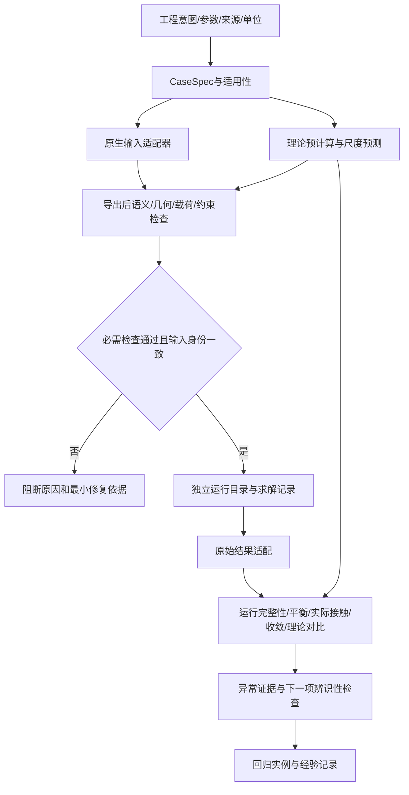

# FEA准备、预计算与结果审查架构

设计日期：2026-10-29。目标：在提交前发现物理定义及离散错误，先形成可解释的理论预期；在求解后按同一物理量审查结果，给出有辨识力的下一步。v0.1先覆盖通用物理量契约、光滑弹性线接触、名义外啮合直齿轮、梁筛查、已有M37的只读适配和受检求解启动。三维通用前处理与自动自适应是后续阶段。

## 系统不变量与影响范围

| 不变量 | 验证 |
|---|---|
| 不改既有M33/M37输入、参考、容差或冻结核心 | 复用文件SHA256；新项目独立目录 |
| UNKNOWN不能成为已验收或静默提交资格 | 必需规则的PASS集合判断、缺证负例 |
| 理论输入不从FE输出反推，不调参追平 | 理论函数只接受输入契约；结果审查另模块 |
| 检查后到启动前输入与代码不能漂移 | 启动重新准备，校验输入/适配器/软件文件身份 |
| 通用层不导入求解器/桌面/AI模块 | 标准库核心；可选原生适配器隔离 |
| 真实平衡、数值收敛、理论对比、工程适用性分别报告 | 无加权总分，失败不得被其他成功抵消 |
| 未支持的材料、齿形、接触或单元不套用已验证规则 | 明确域检查和UNKNOWN/NOT_APPLICABLE |

旧控制器直接接新门会影响冻结结果的可复现性；原地重构也扩大回归面。选择独立代码包、可选只读适配器，在新启动入口接门。当前无旧生产调用方，新增消费者为CLI、检查报告和受检启动器。已有Hertz等小型公式按来源登记复用数学定义，齿形生成/曲边/MPC检查调用旧资产，不重新建立第二套齿形内核。

## 分层

`contracts`负责有限数/单位/身份及规则结果；`theory`给透明理论量与定义；`pipeline`做准备；`adapters`连接已有原生检查；`runner`只在重新验证后执行无shell命令；`review`审查标准化输出并返回诊断；CLI连接这些模块。外部程序可以是CalculiX，后续可替换Abaqus/OptiStruct适配器；MCP只是可选调用表面。

## 理论预计算合同

每个预测均输出：方法、输入、单位、适用条件、预测量、尺度比、参考来源、比较资格。使用者预先配置比较阈值和理由，不使用FE结果校准阈值。

Hertz线接触给等效模量/曲率、接触半宽、峰压及a/R尺度；名义直齿给节/基/顶圆、基节、理论接触比、载荷分解及指定啮合线坐标处曲率。梁模型只给明确矩形悬臂的弯曲/剪切位移和名义根部应力，不能把其应力当真实齿根应力。接触比>1时不可把单齿全载Hertz直接套到所有相位；边缘接触、塑性、粗糙度、有限宽、摩擦、非渐开线等影响需独立声明。

## 结果异常分类

先看运行身份/最后加载步，再看自由体F/M，再看实际接触区域和网格，再看收敛，最后比较理论。典型诊断：载荷/单位错、边界继承错、漏接触、意外齿端接触、未解析高压峰、离散不收敛、参考定义不一致。每个诊断保留实测证据、可能原因和能区分原因的下一检查；没有足够证据时只叫假说。

缩放关系可作变形测试：同一弹性Hertz模型q乘4，则半宽/峰压乘2；线性梁载荷乘2则应力/位移乘2；网格变化必须保持物理载荷区间和合矩；刚体坐标变换后物理结果不变。能量只能比较同一控制体、时间积分/准静态定义下的外功与储能/耗散，不用任意能量百分比通吃。

## 验收矩阵与实施顺序

| 项目 | 本轮退出门 | 状态记录位置 |
|---|---|---|
| 文献和资产核验 | 直接内容证据、固定来源和可复用判断 | research/、asset-audit/ |
| 理论函数 | 独立公开/现有算例、量纲及缩放/域负例 | tests/、artifacts/ |
| 规则报告与准备门 | 缺证/NaN/错单位/错身份不放行 | tests/ |
| M37适配 | 原错面失败、修复输入通过；旧源码hash不变 | artifacts/m37/ |
| 受检启动 | 新目录、输入漂移阻断、真实退出码、超时和错误日志 | tests/；人工小作业测试必须标为synthetic |
| 结果诊断 | 实际ph10触发粗接触区；理想差与平衡分开；未知不会伪PASS | artifacts/m37/ |
| 发布 | 源码包/示例/文档/依赖/测试证据/manifest一致 | dist/、STATUS.json |

后续阶段：真正的逐步通用载荷状态解释器、CAD/网格语义传递、曲面全域间隙与干涉、3D高阶质量、实际接触区局部细化及稳定的网格/接触收敛、独立跨求解器及实验验证。各阶段应引入最小新正负例，不把研究清单当成已实现功能。
