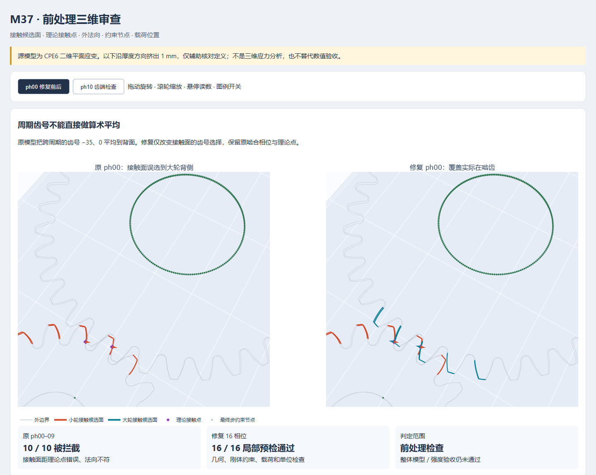

# M37 无头前处理与独立核查交付

**M37 未验收；M33 未验收。** 本包同时保留原基线、独立诊断和新增检查证据，不能把诊断通过当成正式矩阵通过。

## 先看这四份

- [前处理契约与使用方法](preprocessing-work/FEA-PREPROCESSING-CONTRACT.md)：接触、初态、约束、带符号载荷、材料引用、高阶网格以及求解后实际受压区检查。
- [开源流程研究](research/OPEN-SOURCE-FLOW-REVIEW.md)：6个固定版本项目、45份源码/文档；逐项能力和界限，含源码链接。
- [模型定义独立审计](research/MODEL-DEFINITION-AUDIT.md)：P02加载力矩、ph10自由度、跨步状态、真实平衡与刚度定义。
- [交互三维查看器](viewer/M37-preprocessing-3D-review.html)：下载HTML后用浏览器打开，完全离线。CPE6二维边界挤出1 mm，仅作几何辅助。

## 本轮实证

原ph00–09错误接触面全部被预检拦截；原ph10–15及修复16相位通过有限profile检查。反向扭矩、错误材料、悬空材料引用负例被拒绝。TRI6 Jacobian检查经104个独立fixture和共享边负例复核。P02固定载荷片保持跨网格作用矩一致，仍不能消除FE/ISO偏差。

ph10峰压5283.265 MPa位于额外齿端单元7779；该处边长约目标接触h的40倍，原只检查理论点附近的网格门漏掉了实际受压区。新审阅会标出该位置需要局部网格与接触收敛。初态局部间隙采样为正，没有据此确认初始穿透，也没有证明全域无穿透。

按同一轮心比较，ph10接触与反力矩残差约1.571e−5；原约0.3%的指标是对理想传动比/法向力的偏差，两者分别记录。原验收阈值和参考未改变。

## 文件版本和真实运行

三份旧ZIP保持原SHA256：原矩阵、L3周期选面诊断、P02固定载荷片诊断。它们早于本轮附加复跑，因此旧L3报告仍记ph10/ph11退出码未知。新增 `M37-ph10-ph11-identical-repeat.zip` 真实重复相同INP、捕获退出0，DAT逐字相同；**没有回填旧null**。最新严格补充评估见 `repeat-assessment/repeat-independent-assessment.json`，只解决执行证据缺口，不改变旧失败数值。

原矩阵82条台账=73实际启动（66成功、6 MORTAR失败、1中止）+9未启动。原最高连续数值级L1；L2为9/14，L3仍有刚度与理想参考项未通过。无产品强度合格结论。

公开脚本按原工作目录布局运行，需要用户持有的M37题目包和本机Python环境；不是独立安装器。`semantic_preflight.py` 使用原题目JSON，`extended_preflight.py` 使用原包 `ccx_io/cases` 解析，独立审计脚本另行实现解析。原题目和核心整包不在此次公开目录。所有公开文件SHA256列在 `manifest.json`。

M33原生报告与Z12在同级 [M33-native-headless-2026-10-29](../M33-native-headless-2026-10-29/)。核心源码、完整TR30转录、标准全文、第三方研究缓存和账户日志仅本地保留。
