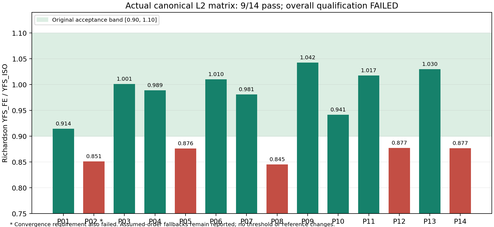

# gearbase v0.20 关门推进交付（2026-11-01）

**M33由2/4推进到3/4**：本轮关闭用户指认的例7/8几何数值范围。VERSION已升0.20、CHANGELOG已更新。本轮没有宣称整项M33或M37通过；原验收线不改。全过程无头执行，未占用鼠标。

| 里程碑 | 严格完成门/总 |
|---|---:|
| M32 | 5/5 |
| M33 | 3/4 |
| M34 | 3/4 |
| M35 | 1/2 |
| M36 | 1/3 |
| M37 | 0/4 |
| M38 | 3/4 |
| M39 | 2/3 |
| M40 | 0/3 |

M32保持关闭，M40保持冻结。M36联合优化27组合、8可行的完整排序与最优解再次核验一致；Claude真实模型调用继续按用户决定暂缓。

## 本轮真正关掉的数值范围

用户对旧“2/6”给出指认：“本地已找到例7/8的8条历史差异且均小于1% ，应该是这几个”。当前公式重新运行这8条，最大相对误差4.7510558934e-5，即0.004751%，均低于1%。这关闭A4当前例7/8几何数值跟进项；门3统计必须带此范围，不能读作所有齿轮族、所有输入域或完整强度主链都已通过。旧六项身份没有追改为已恢复，原1e-6严格门仍报告这8条失败。

补充原生最终刀具诊断共64映射行，只有56个唯一量：50公式、2数值方法、4输入；最大相对差6.05947e-6。原生最终hfP与印刷值不同，数值包络dFf定义仍有限制；完整E4、硬度、fsh0、例8应力与原表输入身份保持开放。凭据核验会重新求值并检查输入、参考、生产者及源码，不能改单个通过标志、数值或门限凑验收。

## 真实 FE 已从“准备”走到完整失败矩阵

精确获准的CalculiX2.23执行了预先固定14个几何点×3网格，共42个L2主矩阵作业。每个原始INP、元数据、DAT、STA及求解器身份绑定；字段和提取量独立重贴通过，**verdict=recorded，数值结果仅9/14通过，L2整级失败**。不能删除失败点凑至少12点，不能把recorded当作资格通过。

失败点为P02、P05、P08、P12、P14。修复外推算法后P08比值约0.84505、P14约0.87657，仍未进入[0.90,1.10]。P02额外加密与原矩阵分开保存。这里揭示的是实际模型/验证差异，已不能继续只写成“缺包、缺本地运行”。L0/L1本包未运行，验证阶梯仍受下级阻断。

图中使用修正后的Richardson结果，保留全部14点和未收敛标记，不使用最细网格比值替代外推值。

另外完成两个预先定义的同网格载荷控制：保持几何、材料、约束、合力和方向，仅用正权重使载荷片合力矩等于HPSTC目标。P08峰值增1.170%，但仍比ISO参考低13.67%；P03变化-0.622%。因此载荷力矩漂移是污染源，但不足以解释主要差异；不宣称ISO遗漏径向压应力，也不据此校准参考。

直齿L3三个网格的派生接触试算也完成：只新增结果输出，物理输入字节保持，粗网格另重跑补足prepared/prelaunch/post身份。压力约604.82/604.71/604.92MPa；同口径Hertz参考602.735MPa，振荡序列采用明确标注的假定阶外推，比值约1.00390。节点C单齿压力不能直接与名义sigmaH0混比；换算口径已列明。尚缺罚刚度、相位研究，且下级L2未通过，**不算完整L3或斜齿门通过**。首次细网格超时及所有尝试均保留。

## 实现缺口与反例已修复

- 显式测量配置为确定哈希的2.23/CPE6提供严格L2入库，默认规范读取器不放宽；DAT尾部篡改、STA/输入/元数据变化、版本/算例错配、缺失力平衡均拒绝。原题目包脚本保持字节，修正后的入库外推另绑定实现哈希。
- 修复Richardson负观测阶被绝对值变为正数、非等比网格比值方向错误；无效阶和振荡明确回退，不伪称观测收敛。
- 实际运行暴露受控数据包内写Python缓存的问题；受保护导入现在隔离模块并恢复路径和字节码标志。普通Python重放真实42作业后，原包24文件哈希不变、无缓存。锁只覆盖这些重放调用，不作任意外部线程的全局导入隔离保证。
- M38修复金标compiled与真实待人工确认状态的评分分类对应；生成空白40题工程师表单，接收完整来源、逐题签名/日期和独立声明，真实答案未填写，原题库未改。声明真实性仍需外部核实，金标门不关闭。
- M35生成同源参数表、尺寸包络SVG、未署名审阅表和完整性验证，修复跨渲染器黑填充及文字重叠并检查预览。现有几何权威拒绝非零变位，尚缺真实变位齿廓/产形齿根与制造输入，不能把圆包络图当完整制造图，更不能靠填签名字符串关闭工艺门。

## 验证与交付

四作业托管CI全部通过：[运行记录](https://github.com/qizhou-hust/yuanqi-private/actions/runs/41298492209)，功能源码提交 `3b27cdfd6c371616384258a5fcd09eeac4de90bc`。Linux核心运行1379项、明确跳过18项；Windows运行1379项、跳过30项。原73模块678/678、零跳过，全新便携Windows通过。跳过不计为通过。

原81文件、18个既有内核Python和真实金标保持字节不变。独立数值复算、冻结前61项复核及只读修复后27项增量复核均随包；后者也独立重贴真实原始ZIP，未提升FE资格。

公开包包含源码、当前报告、真实FE原始数据和可核验哈希；标准扫描件、私有标准数字库及商业原生文件仅留完整本地包。完整包保留历史商业参考及本轮INP/DAT/STA/FRD/日志/JSON。没有新运行KISSsoft，例7/8引用的是固定哈希的历史2026回传。

## 下一步优先顺序

1. M33最后一门：明确HB/HV与fsh0来源、处理例8应力和原表输入身份；不能由本次数值几何通过代替完整E4。
2. M37：针对固定矩阵的5个失败点继续物理/离散模型归因，先处理载荷片及支承边界等控制，再决定后续计算；不为过线拟合输出。L3补罚刚度/相位与下级资格后才可宣称接触门通过。
3. M35：建立经独立校核的变位齿面和产形齿根，再补制造图及真实工艺审阅。M38工程师可直接填写本轮空白表单，完成真实金标。
4. C001/H2真实工程布局材料、油品试验来源和热边界仍需补齐；M40不擅自解冻，Claude客户端缺口按用户决定保留。

[核心源码](core-source/gearbase/gearmath) · [二进制ZIP / SHA256 / base64](https://github.com/qizhou-hust/yuanqi-public/releases/tag/gearbase-v020-2026-11-01)

公开ZIP SHA256：`4b479568bfca70b4cd79f7f2f99d2f68446e34ad8bfaebe602d15536d7a1b107`。

大型FE原始INP/DAT/STA/FRD及矩阵ZIP在上方Release二进制证据包内；源码树保留报告、脚本、输入元数据与哈希索引。
