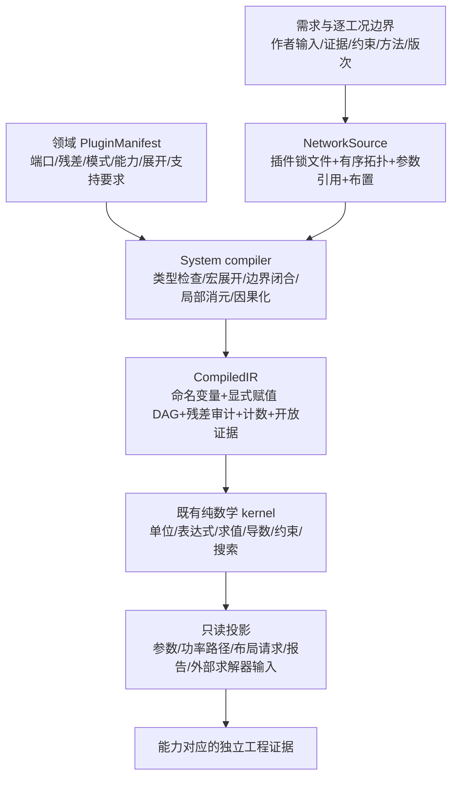

# 传动元件数学插件契约（设计稿）

日期：2026-11-01。对象：`D:/my_Works/Gears/gearbase-v020-work`，冻结基线 `80117283778cf8732b5557fa15c2e41f626f92fc`。本目录是架构分析与独立数学示例，不是新增产品功能，不变更产品代码、现有验收门或冻结声明。

本稿采用“**有类型的元件网络 → 局部消元与因果化 → 现有纯数学 DAG → 分层投影**”。齿轮副、蜗杆副、行星排、丝杆是领域插件；两级行星是可以展开的复合插件。通用 kernel 只处理变量、单位、表达式、约束、导数、求解和证据，不能出现 `if family == planetary/worm/...`。网络的连线规则、机械端口语义和家族公式由 `gear/system` 层拥有。

## 1. 先固定的限制与反例

1. **功率恒等式不是传扭方程。** 零速时任意力矩都满足 `Στ·ω=0`；必须另有运动学约束对应的 virtual-work 力矩残差，含摩擦时还要有静摩擦可行域。示例 `zero_speed_power_insufficient`：`i=4, τa=5, τb=100 N·m` 在两端零速时功率为零，但理想力矩残差 `τb+iτa=120 N·m`，应拒绝。
2. **行星排原始对象是三端口。** 自由环时仅给太阳轮转速不能唯一求行星架转速。固定环是可追溯边界，不是藏在 ratio 默认值里；固定环的反力矩仍需输出。
3. **蜗杆/滑动丝杆反向模型有不可逆域。** 简化表达式算出 `ηback≤0` 时，不能把它当可用效率再除。应退出“负载反驱滑动”分支；静止保持、起动和外加反向驱动分别需要额外模型或证据。
4. **1D 端口不能证明 3D 布置和支承成立。** 两根平行轴可以相距 0 或 40 mm，`orientation="parallel"` 不足以区分。1D 转矩也不包含啮合径向力、轴向力、支承跨度、轴承预紧、壳体刚度和全行程干涉。
5. **宏封装不减少物理级数。** `2P + H + W + screw` 是 4 个齿轮传动级、1 个末端转动/直线转换；不是“4 个插件所以总共 4 级”。
6. **现有图是 DAG。** `gearmath/kernel/graph.py:253` 遇循环依赖会拒绝；`kernel/coupled.py:26` 是指定顺序的标量不动点迭代，不是通用 DAE、约束动力学或静摩擦互补求解器。首版仅对固定角色串联网络局部消元/因果化，不能因接口中有 residual 字段就宣传支持任意方程网络。

## 2. 范围与设计取舍

首版网络限定：一个驱动端、一个负载端、固定连接、串联传动、固定环简单行星、显式支承边界、逐工况固定的功率流分支；最多 4 个齿轮级。分流/汇流、差速使用、离合、换挡、运行时拓扑切换、任意闭环机构和全局 DAE 均关闭。行星仍保留三端口数学原型，首版网络编译只允许声明了固定环边界的缩约形式。反转是工况，反驱是功率流，二者不同。

考虑的路线：

| 路线 | 可复用内容 | 主要代价 | 本稿判断 |
| --- | --- | --- | --- |
| 每个家族各写一套整机计算 | 现有专用 H2/P2/W2W 入口 | 总传动比、损耗、证据、级数反复复制，难以插接 | 保留旧入口，不扩成新总架构 |
| 有类型网络，家族插件输出约束，串联工况编译成 DAG | 现有 Graph/Expr/units/source/evidence/optimizer 与领域核算 | 新增端口类型、展开、因果化、能力清单和投影协议 | **建议采用**；增量边界最清楚 |
| 先建设通用多物理 DAE/多体系统 | 未来可能统一瞬态 | 当前无积分器、结构分析和事件求解证据，重写面大 | 作为后续独立能力，不作为首版前提 |

上述是本稿建议，不冒充用户已经批准的实现方案。此处交付设计，不进入产品实现。

## 3. 层级、唯一真源与中间表示

- `PluginManifest` 是数学与能力契约，不是一个大 `calculate()` 函数。它声明参数、端口、适用域、约束与力矩方程、可用模式、因果签名、损耗接口、级数贡献、复合展开和装配前提。其 schema 见 [component-contract.json](component-contract.json)。版本锁必须包含插件语义版本和内容哈希；同版本变内容即冲突。
- `NetworkSource` 是系统装配的作者记录；它引用既有 `gears.math-source/2` 和 `gears.system-input/1` 的**不可变修订与哈希**。既有输入仍归其来源文档所有，不在新 JSON 再复制成另一个可编辑真源。新端口/拓扑参数只在网络真源拥有一次。可先引用不可变文件，未来再统一修订容器。
- `CompiledIR` 是只读构建产物。保存宏→叶子映射、级序、已选择模式、边界、局部未知量消元依据、规范单位映射、DAG 赋值、原始残差引用、计数和开放证据。结果必须能回指原始子元件和方程。
- 规范参数 hash、源文件字节 hash、插件锁 hash、IR hash、投影输入 hash 分开命名。作者修订变更、插件/单位目录/方法版次/编译器/工况/布局修改，均使相应投影失效；不可凭设计 ID 命中旧缓存。
- 作者文件不接受 `n_out/T_out/efficiency_total/CAD_bounds/results` 等派生写回。采用优化建议时形成新作者修订，保留父 hash。外部工具结果作为带证书、单位、工况、方法版次和作用域的证据输入，不覆盖数学来源。
- 投影版本独立于真源版本。1D 数学结果不含足够几何时，`cad_request` 应输出 `blocked_missing_layout`；不得用默认方位生成貌似成立的 CAD。

## 4. 符号、单位和端口的功率约定

所有机械 effort 均为**外部作用到本元件的力矩/力**，正值沿端口已声明的正轴；流为相同轴上的运动速率。功率正值表示能量进入元件。`a/b` 或 `sun/carrier` 名字不固定谁在驱动；驱动角色由当前工况的正功率判定。输入、输出可作为选定因果签名的角色，不能做两种不兼容端口类型。

| 端口 | across/坐标 | through/effort | 流 | 入元件功率 |
| --- | --- | --- | --- | --- |
| 转动 1D | `φ [rad]` | `τ [N·m]` | `ω=dφ/dt [rad/s]` | `τ·ω/(1 rad)` |
| 平动 1D | `x [m]` | `F [N]` | `v=dx/dt [m/s]` | `F·v` |
| 传热 | `T [K]` | `Qdot_into [W]` | 热流本身已是功率 | `Qdot_into`；**不乘 T** |
| Ground | 不是新物理端口域 | 与被固定端口同类型的未知反力/矩 | 固定坐标并令速率零 | 0，但 reaction 仍保留 |

机械 effort-flow 是功率共轭对。常用 `T/Qdot` 热端口则是 across/through；若以后采用严格 bond-graph 热功率对，应另设熵流 `Sdot` 并用 `T·Sdot`，不能把两种接口混用。[Modelica 的机械 flange](https://doc.modelica.org/Modelica%204.0.0/Resources/helpWSM/Modelica/Modelica.Mechanics.Rotational.UsersGuide.FlangeConnectors.html)给出角度和 cut-torque；[HeatPort 源码](https://raw.githubusercontent.com/modelica/ModelicaStandardLibrary/v4.0.0/Modelica/Thermal/HeatTransfer/Interfaces/HeatPort.mo)把热流正方向定义为进入组件。

**与现有单位系统的兼容缺口必须保留为显式工作。** `kernel/units.py:1-5,46-88` 使用 `mm/N/s/rad/K`，且角度是独立维 A；`rpm` 的规范数值是转/秒，当前目录没有 `rad/s`、`1/s`、`kg*m^2` 等全部新接口单位。`kernel/expr.py:70` 已识别 `rad` 常量。设计端口采用物理角速度，在公式里除以 `rad` 消去角度维；virtual-work 则以 `θ=φ/(1 rad)` 为广义转角。`ω=2π·n_rev_s·(1 rad)`，不得把 `rpm` canonical 的 `n_rev_s` 直接当 `ω/(1 rad)`。后续只能做通用单位目录增量或明示的 adapter 投影，不改变角度维、不隐式丢 `2π`。本稿 schema 中新单位不代表当前 kernel 已支持。

连线必须先映射到共同坐标：若局部量 `q_j=σ_j q_net+q0_j`，则流 `f_j=σ_j f_net`，结点平衡 `Σσ_j e_j=0`，`σ=±1`。坐标偏置有单位且来源明确。热连接要求温度相等、热流入量求和为零，不能使用 `σ=-1` 反转绝对温度。Ground 施加固定坐标/速率并接收反力，不能同时强制其 effort 为零。

## 5. 理想约束、力矩残差、损耗与静摩擦

令 `q=(θ1,...,x1,...)`，转角均为归一化 `θ=φ/(1 rad)`，平动用 m；`e=(τ1,...,F1,...)` 与各项共轭。对无质量、无储能、无损耗元件：

\[
c(q,p)=0,\qquad J=\partial c/\partial q,\qquad J\dot q=0,
\qquad e-J^T\lambda=0.
\]

每个残差有单位与 scale；乘子单位由该约束决定。若对物理角 `φ` 求 Jacobian，则共轭 effort 是 `τ/(1 rad)`，不能漏掉角度维。virtual-work 的结论是 `e^T qdot=λ^T J qdot=0`；功率恒等式是审计，不取代 effort 方程。零速仍由 `e=J^Tλ` 给出传扭关系。

有损耗、但仍不计惯性时，采用 `e=J^Tλ+d`，且 `D=d^T qdot≥0`。`d` 由有适用域的摩擦/搅油/密封/轴承/啮合损耗模型提供。比如把所有简化损耗折算到 a 轴，`d_a=sign(νa)·Tf(|νa|,载荷,T,油品,...)`，其中 `νa=ωa/rad`；不把同一轴承损耗同时放在齿轮插件和轴承插件里。损耗拥有者在 assembly manifest 唯一指定。

静摩擦是集合：`νa=0` 时允许 `d_a∈[-Ts,Ts]`；滑动时为相应的速度/载荷相关分支。未知的 Ts 不能由正向效率倒推出。非光滑边界不承诺普通梯度；mode/guard、分支裕度和敏感性不可用原因一并投影。摩擦锥或负载相关自锁模型须有自己的域，不能以这个常数阈值小例子代表所有蜗杆/丝杆。

机械与热能量分别写为：

\[
\sum P_{mech,into}=\dot E_{mech}+D,\qquad
\dot E_{thermal}=D+\sum \dot Q_{into}.
\]

准稳态无储能时 `ΣPmech=D`、`ΣQdot_into=-D`；系统总体能量残差为 `ΣPmech+ΣQdot_into=0`。`η=|Puseful|/Pdriver` 是已选驱动分支、非零功率点的派生量，不能充当全域本构，也不能在零载/零速以 `0/0` 补成 1。

## 6. 各类插件的数学原型

### 6.1 平行轴斜齿副：固定参考系下的二端口

本节参考系固定于刚性壳体，转角按各自正轴归一化。令有符号比 `i=νa/νb≠0`；若两轴正向沿同一空间方向，外啮合 `i=-zb/za`，内啮合 `i=+zb/za`。几何模型决定符号，不能把 `abs(i)` 和“旋向”字符串拼回去。

\[
c=\theta_a-i\theta_b-c_0=0,\quad
\nu_a-i\nu_b=0,\quad
\tau_b+i\tau_a=0.
\]

带 a 轴折算耗散时 `τa+τb/i-d_a=0`。若整个支持可沿共同平行轴转动，运动学要改用相对支持转角；若轴线不平行，则不存在一个可替代所有壳体运动的标量支持角。首版固定壳体，不把上述二端口式推广为任意移动壳体模型。[Modelica IdealGear 源码](https://raw.githubusercontent.com/modelica/ModelicaStandardLibrary/v4.0.0/Modelica/Mechanics/Rotational/Components/IdealGear.mo)展示了相对支持角及独立的传扭方程。

几何/强度是该插件的其他能力：平行斜齿与交错轴斜齿需要不同几何和承载方法。固定轴锥齿副也可复用二端口理想约束，但要使用自己的轴角、几何、载荷和评级插件。1D 端口相似不意味着 ISO 6336 平行轴评级可以转作交错轴/锥齿额定能力。轴向力方向依赖螺旋手性、转向、接触侧、坐标；不能仅由一个标量 ratio 推出。

### 6.2 简单行星排：先保留三端口，再固定环缩约

假设简单太阳轮 s、内齿圈 r、行星架 c，齿数为正整数；同轴、三个转角共用同一正轴、同一惯性参考系；理想刚性、无滑动、忽略惯性和损耗。`k=zr/zs>0`。未变位参考几何才直接使用 `zr=zs+2zp`，有变位必须走实际工作中心距/几何条件。

\[
z_s(\nu_s-\nu_c)+z_r(\nu_r-\nu_c)=0,
\qquad \nu_s+k\nu_r-(1+k)\nu_c=0.
\]

这是不除以 `νr-νc` 的 Willis 形式，避免分母为零。由 `J=[1,k,-(1+k)]` 得：

\[
\tau_r-k\tau_s=0,\qquad
\tau_c+(1+k)\tau_s=0,\qquad
\tau_s+\tau_r+\tau_c=0.
\]

第三式是前两式的审计身份，不作为额外独立约束重计 rank。[MSL 4.0.0 IdealPlanetary 源码](https://raw.githubusercontent.com/modelica/ModelicaStandardLibrary/v4.0.0/Modelica/Mechanics/Rotational/Components/IdealPlanetary.mo)给出相同三端口运动学与力矩关系；该理想组件明确忽略惯性等效应。

固定环边界 `φr=φground`、`νr=0` 后，太阳轮输入、行星架输出有 `i=1+k`。`τr=kτs` 是**壳体作用到行星排**的力矩，行星排作用到壳体为其负值；功率为零不表示反力矩为零。`k=3, νs=100 s⁻¹, τs=5 N·m` 时，`νc=25 s⁻¹, τc=-20, τr=15 N·m`；输入 500 W、输出 -500 W。自由环同一输入速度可以有多个输出速度，首版拒绝未闭合的环，而非自动固定。

含损耗时仍保留运动学式，effort 方程增加有物理依据的分支耗散与支承反力。不能给三端口统一乘一个 η；内部相对啮合速度与分流功率需要专门模型。首版只开放固定环准静态分支。`Kγ`、行星载荷分配、行星自转与公转惯量、销轴/滚针支承、环柔度分别是独立能力，不从 Willis 公式推导成“已有”。

### 6.3 两级固定环行星：复合节点与展开一致

宏内部为 `P1.carrier → P2.sun`，两个 ring 各有显式固定边界。默认无额外串联轴损耗的理想示例有 `i_total=(1+k1)(1+k2)`，中间结点 `νc1=νs2`、`τc1+τs2=0`。每一级的齿数、行星数、反力矩、损耗、单位、能力和证据仍可独立追溯。宏只暴露端口映射；不能再另加一条独立的总效率/总力矩计算当真源。

**当前 schema 的安装缺口：** 宏对外只有 input/output 功率端口。内部 `reaction_output_ref` 保留两个固定环反矩的命名，`reaction_obligations` 记录对外投影义务；它们尚不是完整、有类型的 mount/wrench-to-housing 连接。结构化 axis/frame 也不等于该力学连接已实现。因此首版数学回执须显式输出两个反矩并将安装/壳体载荷映射标 `OPEN`，没有映射就不能给“箱体载荷路径已闭合”的结论。后续装配合同应把反矩、作用点、轴向、坐标变换和安装实体绑定起来，不能以内部 ground 代替这一工作。

以 `k1=3,k2=4` 为例，理想总比 20，一级输入 `ν=100,τ=5` 时，中间速度 25、二级太阳轮入矩 20，末端输出力矩 -100；两个环入矩分别 15 和 80。宏与展开网络必须在暴露端口、总功率、每级边界和计数上一致。现有 P2 仅作为有限整数几何枚举器复用，不能借宏定义把它升级成整机承载/效率验证。

### 6.4 蜗杆副：带方向和可逆域的准静态插件

运动学比的绝对值 `|i|=z_wheel/z_worm_starts`，有符号映射还需要轴系与手性。以下是等效摩擦斜面**筛选模型**，不是 ISO/TS 14521 或 DIN 3996 完整评级：导程角 `γ∈(0,π/2)`，等效动摩擦角 `ρk′=atan(μeff,k)`，且 `γ+ρk′<π/2`。

\[
\eta_{worm\ driving}\approx{\tan\gamma\over\tan(\gamma+\rho_k')},\qquad
\eta_{wheel\ backdriving}\approx{\tan(\gamma-\rho_k')\over\tan\gamma}
\quad\text{只在 }\gamma>\rho_k'\text{ 的反驱滑动域使用。}
\]

本模型静止自锁筛选另用 `ρs′=atan(μeff,s)`：`γ≤ρs′` 提示负载反驱静止可行域。静、动摩擦必须区分；可能“静止能保持、扰动后能滑动”。若 `ηback≤0`，不能给负输入功率/负耗散结果；返回 `blocked_static_mode` 或 `blocked_domain` 并列出所缺起动/保持模型。若是**外部电机从蜗轮端强行驱动**，也不能把“负载自行反驱受阻”误述为任何外加力矩下永不能运动；需单独边界与本构。

应输入负载、相对滑动速度、油温、润滑/表面/材料和适用域，输出逐点损耗、功率方向、热源、反驱分支可用性。承载、胶合、磨损、热平衡和轴向支承另行闭合。[KHK 技术资料，第 400 页](https://khkgears.net/pdf/worm-tech.pdf)指出实际自锁还受材料、精度、轴承和润滑等影响；不能将筛选条件当保持安全证据。[MSL LossyGear](https://doc.modelica.org/Modelica%204.0.0/Resources/helpWSM/Modelica/Modelica.Mechanics.Rotational.Components.LossyGear.html)把静止锁定与滚动分支显式建模，可借鉴其能力分层，不能直接宣称本项目已有该事件求解器。

### 6.5 丝杆/旋转螺母：四个原始机械端口

令同轴 screw/nut 各有转角与轴向位移：`θs,θn,xs,xn`；`L>0` 是每相对整转的导程 [m/rev]，`h=±1` 为**手性与本地正轴共同确定的运动学符号**，不能直接把字符串 `right_hand` 当 `h=+1`。定义 `a=hL/(2π)`：

\[
c=(x_s-x_n)-a(\theta_s-\theta_n)-c_0=0,
\quad J=[-a,a,1,-1].
\]

理想 effort `[τs,τn,Fs,Fn]=λ[-a,a,1,-1]`。旋转螺母/平动丝杆配置施加 `νs=0`（丝杆防转）和 `vn=0`（螺母轴向固定），才缩约成螺母旋转输入与丝杆直线输出；两个被固定端口分别保留防转反矩与推力反力。转动丝杆/平动螺母应使用另一组边界，不能只换显示名字。理想转矩幅值 `Tideal=F·L/(2π)`。[MSL IdealGearR2T](https://raw.githubusercontent.com/modelica/ModelicaStandardLibrary/v4.0.0/Modelica/Mechanics/Rotational/Components/IdealGearR2T.mo)可借鉴旋转和平动支持分开的接口；螺纹内部四端口的展开仍由本领域插件定义。

滑动梯形螺纹的筛选取 `dm` 中径、`λlead=atan[L/(πdm)]`、法向螺纹半角 `αn`、`ρ′=atan[μ/cos(αn)]`。在这个明确选定的等效摩擦模型内：

\[
T_{raise,thread}=F{d_m\over2}\tan(\lambda_{lead}+\rho'),\quad
\eta_{raise,thread}={\tan\lambda_{lead}\over\tan(\lambda_{lead}+\rho')},
\quad
\eta_{back,thread}={\tan(\lambda_{lead}-\rho')\over\tan\lambda_{lead}}
\ \text{仅用于正值的负载反驱域。}
\]

法向半角与轴向标注角须按几何约定换算；未换算时不能声称精确。升载力矩再加实际 collar/轴承/密封损耗，不把它们藏进线程 μ。[Roton 正向式](https://www.roton.com/screw-university/formula-calculators/efficiency-power-screws-forward-drive/)与[反驱式](https://www.roton.com/screw-university/formula-calculators/efficiency-power-screws-backdrive/)可对照上述摩擦角形式。材料/润滑/温度相关 μ、静摩擦阈值和几何是假设时须标 `ASSUMED`。滚珠丝杆要单独使用滚动接触/预紧/供应商模型，不能继承此滑动摩擦公式。丝杆屈曲、临界转速、PV、磨损、螺母寿命、防转与端部保持均不由功率闭合证明。

### 6.6 轴、轴承与壳体：装配附属角色，也有独立数学能力

- 轴段是连接载体，可声明惯量、扭转刚度、强度/挠度；理想刚轴只连接同轴端口，不增加传动级。必须给齿轮落点与支承位置后才可做梁/载荷校核。
- 轴承约束不同自由度，并拥有额定寿命、静载、预紧/游隙、摩擦等能力；必须声明轴向定位/浮动策略，不能把所有 bearing 简化成 `ground` 或把重复轴向固定当无条件正确。
- 壳体/箱体提供坐标基准、安装界面、反力汇集和热边界；首版可以做刚性支承假设，但应标 `ASSUMED`。没有结构模型时，不给壳体强度/刚度合格结论。
- 啮合载荷必须从正确的几何/接触模型产生**在已知点、已知坐标系的力与力矩**，再投影给既有 shaft/bearing 工具。非平行轴不能用 `τa+τb+τhousing=0` 这种标量式替代空间合力矩平衡；应变换 wrenches，含作用点平移的 `r×F`。

## 7. 1D 连接、真实 3D 布置与自动建模投影

1D 端口描述允许的自由度与功率交换；3D layout 描述轴线、位置、方向、支承和包络，二者通过稳定的 datum ID 关联。每个刚性布置存 `T_parent_from_local`：`R∈SO(3), RᵀR=I, det(R)=+1` 和平移 `p [m]`，加本地轴线 `o+λâ`、安装平面、接口半径/孔/肩位置等引用；父图不可有环。schema 的 `axes` 保存结构化原点/方向/frame/datum，`port_axis_bindings` 关联端口和轴线，`layout_constraints` 保存轴线关系及有来源的目标量；这些数组为空时可做所需数据齐全的 C1 筛选，但不能申请布局能力。

已变换轴线需要区分同轴、平行偏置、相交、异面；轴夹角由 `acos(â·b̂)`，平行轴线距由 `||(ob-oa)×â||`，非平行轴线最短距由 `|(ob-oa)·(â×b̂)|/||â×b̂||`。接近退化角时使用稳健分支与声明公差。接口直接连轴要求轴线重合及匹配的轴向/相位 datum；跨轴的齿轮插件才可以映射两条不同轴线。

斜齿手性、蜗杆手性、齿轮啮合面、中心距、轴角、齿宽占位和支承落点必须来自参数和约束，不能用 `orientation="parallel/right_angle"` 替代。`layout_3d` 通过只证明布局约束；简化包络通过只证明当前包络模型。精确齿形、真实装配可制造性、全行程干涉和 STEP/native-CAD 仍需对应几何生成与验证能力。

建议的建模顺序是：选定数学候选 → 实例化轴线/支承/datum → 求布局约束 → 分配轴承/轴/壳体附属件 → 生成带 revision/hash 的 CAD 请求。CAD 端回传几何证据及映射，不把 CAD 拓扑重新推断成另一个传动真源。本稿不生成 CAD，也不承诺现有模型导出器已经兼容此协议。

## 8. 四类计数与有限组合库

必须同时持久化投影计数：`gear_reduction_stages`、`top_level_plugin_nodes`、`expanded_leaf_plugin_nodes`、`assembly_accessories`、`mesh_interfaces`、`mesh_families`、`terminal_conversions`。这些都是展开网络的派生量，作者只提供明确的查询口径。

| 元件 | 齿轮级 | 物理啮合接口数 | 末端转换 | 说明 |
| --- | ---: | ---: | ---: | --- |
| 斜齿副 / 蜗杆副 | 1 | 1 | 0 | 齿轮级按一个固定轴齿轮副计，即使速比 1 或为增速 |
| 单简单行星排、np 个行星 | 1 | `2np` | 0 | 两种 mesh family；不是 `2np` 个传动级 |
| 两级简单行星宏 | 展开后 2 | `2np1+2np2` | 0 | 宏自身局部计数为 0，避免重复计数 |
| 丝杆端转换 | 0 | 0 个齿轮啮合接口 | 1 | 螺纹接触另记，不冒充齿轮 mesh |
| 轴/轴承/壳体/ground | 0 | 0 | 0 | 仍是装配附属/边界节点 |

`mesh_interfaces` 是并行物理啮合副数，不是同一瞬间接触的齿对数、接触比或激励谐波数。惰轮传递有两副啮合，按本稿齿轮副级定义计 2 级，不能因总比不变就省级。非简单复合行星必须给出自己的展开规则，不能套用 1 级默认。

查询须显式给 `limit_basis`：`gear_reduction_stages≤4` 或 `gear_stages_plus_terminal_conversions≤4`；缺失则 `blocked_missing_stage_limit_basis`。`2P+H+W+screw` 在前者可通过级数筛选，在后者以 5>4 被拒绝。宏的数目不用于这个限制。正序/倒序构造不同候选，不能用排序后的家族集合去重。

有限库的正确粒度是**有序拓扑模板 + 参数域 + 插件/模型/证据版本**。先枚举 ≤4 级允许的有序连接与固定边界，再枚举有限齿数/模块/导程/供应件域；按端口类型/级数/几何前提、运动学/扭矩/功率、损耗/热、承载/寿命、布局逐层筛选。库条目可缓存区间和代理模型用于初筛，但命中后需按当前完整合同重算；外推/域外不能标为已可行。若结果只覆盖理想运动学，就输出 `kinematically_feasible`，不输出 `engineering_feasible`。

级序反例 `stage_order_absolute_loss` 用人为明确的 `D=Tc|νin|+bνin²` 说明：相同总比 50、末端 100 N·m、入口 100 s⁻¹，A(5)→B(10) 与 B→A 均输出 200 W，但损耗分别 34.4 W 与 31.2 W，中间载荷也不同。这是数学反例，不是任何实际齿轮效率数据。

## 9. 编译语义、能力和证据

schema 只检查结构；`source_doc.validate_schema()` 当前是 JSON Schema 子集，不能自动视为支持此稿的 `$ref/oneOf/if/then/minItems`。正式实现应明确选用合格验证器或受控转换，不能“解析成功”就叫合同通过。manifest 中的模式 guards（如 `==`、`!=`）与物理残差是契约描述，当前 `Expr` 不原生支持其中所有关系或新单位，必须由类型编译层验证并降低到受支持的数值谓词/赋值；不得直接 eval，也不得宣称 JSON 可以直接执行。以下跨字段规则不可省略：

本目录的 `parameter.domain` 明确限定为机器可识别数值谓词：比较式及 `and/or` 组合、算术、同一插件已声明的参数名和 `pi/rad` 常量；不支持函数调用、属性、容器、字符串字面量或自然语言。校验器按 AST 的完整标识符核对引用，不对 source/notes 的说明文字做全词扫描。宏参数改名前缀时，域中的参数引用必须同步改名。该检查只覆盖语法与引用，不验证量纲、真假或可满足性。

IR 的 `residual_refs` 与 `assignments.source_equation_refs` 也要静态解析到真实方程/边界/连接 ID：内部 ID 以前属实例 ID 为前缀，顶层边界/连接以前属 network source ID 为前缀，不生成隐含别名。例如两个固定环边界的真实引用是 `P2.ring1_fixed` / `P2.ring2_fixed`，不能写成未声明的 `P2.p1.ring_fixed` / `P2.p2.ring_fixed`。这只是草稿引用完整性检查，不证明编译/消元过程成立。

1. ID/符号唯一，参数绑定齐全，引用可解析，宏无递归；输入与派生量单一拥有者，插件锁、方法版次和证据 hash 一致。
2. 端口域与语义类型相容，角度单位/速率桥正确；旋转→平动须经过转换插件，不能用同量纲数值硬连。绝对温度连接只允许同号。
3. 宏展开后重新计算级数与 ordered path；展开后仍只有一条主功率路径，固定环/防转/推力支持显式闭合；排除分流、离合和换挡插件。
4. 当前工况自由度/方程秩与边界一致，审计身份不计为独立方程；缺固定环是欠约束，给定不一致的 sun/ring/carrier 三速是冲突。静态 friction-feasible set 不假装有唯一解。
5. 每个局部模式有明确因果输入/输出、域与消元/标量求解契约。流沿路径传播，已知负载下 effort 向上游传播；温度/载荷相关耦合若形成 SCC，必须被已声明且检查残差的局部块消解，否则返回 `blocked_unsupported_solver`，不能把循环塞进 Graph。
6. 逐元件运动学、effort、边界反力、损耗非负和整链能量审计分别核查；残差按物理单位 scale 归一化。选定工况不可仅凭转速符号选择效率分支，必须看功率方向。
7. 输出可请求的能力取所有依赖的交集/最弱环节。`not_supported`、缺失输入、域外和开放证据各给具体原因；不将整个插件压成一个“已支持”布尔量。

建议能力分层：

| 层 | 需要的模型/数据 | 可声明的结论 | 不能自动提升为 |
| --- | --- | --- | --- |
| C0 结构/类型 | 端口、边界、版本、参数域、级数 | 网络可构造 | 几何/承载成立 |
| C1 理想准静态 | 运动学 + virtual-work effort | 理想速度/力矩/反力路径 | 实际效率与保持能力 |
| C2 有损准稳态 | 有域的损耗/温度/油品/功率分支 | 工作点输入功率与热源 | 瞬态温升、寿命、实测效率 |
| C3 静止/起动 | 静摩擦集合、阈值、分支解法 | 在模型域内可保持/可起动 | 振动/磨损后的安全保持 |
| C4 承载与装配 | 家族额定方法、载荷向量、轴/轴承/布局 | 各方法作用域内的核算结果 | 完整生产释放 |
| C5 动态（后续） | 惯量/柔度/阻尼/事件/初值/积分器 | 特定动态模型的时域结果 | 真实 NVH、接触冲击或 dBA |

未来动态接口可声明 `M(q)qdd+h(q,qdot)=f_ext+Jᵀλ-f_loss`，约束需同时满足 `c(q)=0`、`J qdot=0`、`J qdd+Jdot qdot=0`，并给一致初值。这里的符号在归一化广义转角下使用。行星轮自转/公转惯性与共享轴惯性各有唯一拥有者；简单在太阳轮和架端随意加等效惯量不能冒充完整模型。本稿不实现积分器、DAE/事件求解、FE 或 GUI；任何动态请求均阻断为能力缺失。

`implementation_status` 与 `evidence_state` 是两个维度。代码存在不等于已验证；数学示例通过不等于工程验证。证据固定三态 `VERIFIED/ASSUMED/OPEN`，并附 `evidence_scope`（文件检查/数学示例/集成运行/独立方法/测量）、适用域、来源和局限。现有 E0–E6 公式链保留，不用新三态覆盖它；投影可并列显示“公式链等级、输入假设、插件能力、工况覆盖”。`citation` 仅文字来源不得升级为外部复核证书。

## 10. 现有代码的增量复用映射

下表是当前冻结代码的静态检查结论，不表示运行了这些产品路径或认可其全部工程范围。旧专用入口及原有测试/门保持原状。

| 现有路径与证据位置 | 已有内容 | 新架构如何复用 | 不应声称 |
| --- | --- | --- | --- |
| `gearmath/kernel/graph.py:49,83,105,133,241,294` | Formula/InputSpec/Model、DAG、状态、单位与域检查 | 将已因果化 assignments 装配为现有 Model；保留原 residual 作审计 | 原生任意隐式 residual/DAE |
| `kernel/expr.py:54,70,100`，`kernel/units.py:24,46` | 安全表达式/量纲，独立角度维 | 复用 AST 和 unit catalog；新速率/惯量单位只做通用扩展 | 现有目录已覆盖全部端口/动态单位 |
| `kernel/source_doc.py:37,64,136,177,197` | 规范 hash、来源分区、派生量锁定、最小 schema | 真源机制继续用；新网络 schema 明确独立版本 | 当前 validator 支持完整 draft2020-12 |
| `kernel/evidence.py:45`、`kernel/registry.py:94,175` | 公式证据传播与注册表规则 | 插件引用公式 ID/证据链，增设能力/域/集成覆盖 | 元件级 VERIFIED 自动传给所有工况 |
| `kernel/declared.py:47,174`、`kernel/optimize.py:217,283` | 声明变量/约束、通用有限/数值搜索 | 外层有限组合库、连续参数问题复用 evaluator 接口 | 搜索到结果即工程验证或全域最优 |
| `kernel/coupled.py:26` | 有序标量不动点数值兼容原语 | 仅在明示的局部块契约与收敛/残差检查中评估是否适用 | 通用结构分析/事件/DAE 求解器 |
| `gearmath/gear/math_source.py:48,63,98,105,176` | 圆柱副 source build/回执/参数投影/证书 | 斜齿副 rating adapter 引用不可变旧真源；不复制公式 | 该 source 格式已原生表示全部网络家族 |
| `gearmath/gear/h2_flagship.py:26,85`、`flagship_h2.py:20` | H2 几何 evaluator / 声明式编译与 sampled stage0 | 作为既有特定几何候选供应者挂接，并保留原域 | 任意 H→H 全域承载合格 |
| `gearmath/gear/flagship_p2.py:64,87,137` | 固定环 P→P 有限整数几何、显式未实现强度/效率/热 | 二级行星宏的几何候选 adapter，保留原范围/枚举口径 | 行星整机评级/效率/制造释放 |
| `gearmath/gear/flagship_w2w.py:10,39,56` | W→W 特定常摩擦筛选、热简化与未支持评级列表 | 作为旧筛选来源，常摩擦输入保留 ASSUMED | 新插件已有双向摩擦/热/承载闭合 |
| `gearmath/system/shaft_line.py:36,44,115`、`shaft_beam.py:89,243` | 啮合点载荷转换、轴/支承/梁、轴承接口 | 布局载荷投影后调用现有系统方法 | 标量转矩能自动补出全部支承数据 |
| `gearmath/system/thermal_balance.py:26` | 显式温度 bracket 内的油温标量平衡 | 作为限定域内局部热平衡块 | 通用瞬态热网络 |
| `gearmath/product/system_input.py:21,82,143` | 来源叶子与 from_design 引用/解析 | 引用继承，不双写派生数值 | 输入 schema 已含全部新网络字段 |
| `gearmath/product/system_optimize.py:129,147,162` | pair_model 范围的联合有限搜索，明确无 worm/planetary 全系统评级 | 作为旧模式 adapter；新编排仍只调用领域服务 | 把 pair_model 入口改名就能支持任意组件 |
| `gearmath/tools/architecture_guard.py:1,19,63` | gear/system 拥有领域计算、kernel 通用、product/tools 编排 | 遵守原 ownership；新增规则若需要应另案评审 | 本稿变更或放宽了现有架构门 |

拟新增职责而非重写：`gear/components/*` 拥有家族数学插件与既有计算 adapter；`system/component_network/*` 拥有机械类型、连接、宏展开、支持边界、因果化和布局投影；`product/*` 只负责编排筛选/解释/报告；`tools/*` 提供入口。上述均为建议的未来路径，当前尚未建立。

## 11. 最小验收矩阵（未来实现的标准，不是本次产品门）

| ID | 验收对象 | 正例 | 必须拒绝/降级的反例 | 本目录证据 |
| --- | --- | --- | --- | --- |
| M01 | 端口单位/类型 | rpm→rad/s→W 对齐；同域同 datum 连线 | rpm 值直接当 rad/s；rot wire 接 trans | 数学示例与 schema |
| M02 | 理想 effort | 非零速与零速均满足 Jacobian 转矩式 | 功率为零但力矩式不满足 | `zero_speed_power_insufficient` |
| M03 | 行星闭合 | Willis + effort +固定环反力闭合 | 自由环默认固定；冲突的三速边界 | 三个行星示例 |
| M04 | 复合展开 | 宏与两叶子的暴露量/反力/功率/级序一致 | 宏算 1 级；丢内部反力 | `two_stage_planetary_macro` |
| M05 | 摩擦/模式 | 正向与可逆域耗散非负，静摩擦阈值有来源 | ηback≤0 继续反除；只看转速方向选模式 | worm、holding、power-direction 示例 |
| M06 | 丝杆 | 两种边界配置各闭合，防转/推力反力保留 | 省防转边界；混用螺距和导程 | 四端口 screw 示例 |
| M07 | 级序/计数 | 展开后有序重算每级速度、转矩、热与四类计数 | 只按总比/插件数筛选；无级数口径 | stage-order/count 示例 |
| M08 | 布局 | 有效 SO(3)、位置/轴线/datum、布局约束 | 反射矩阵/仅 orientation/平行偏置直接连轴 | 两个 layout 反例 |
| M09 | 现有内核边界 | 解析消元后有向无环赋值，残差回算 | 任意循环/DAE 默认可解 | 静态代码证据；待未来集成 |
| M10 | 真源/版本 | 修改一参数使相应 IR/投影失效 | 回写派生结果；旧 hash 命中；双真源漂移 | schema 形状；待未来集成 |
| M11 | 能力/证据 | C1 请求可返回数学结论；缺证据逐项 OPEN | P2 几何通过即“强度/效率通过” | 能力 schema；待未来集成 |
| M12 | 回归/增量 | 旧 API、原冻结算例和原门原样通过 | 为新架构更改旧常数/验收口径 | 本稿未改代码；未跑产品全门 |

运行 `python validate_math_examples.py`（Python 3 + `jsonschema`）只校验本目录 JSON 结构和有限数学例子/反例，生成 `math-example-results.json`，标明 `mathematical_examples_only`。它不调用产品核算、不测工程容量、不替代 M01–M12 的未来集成验收，不承诺未实现的网络编译器。文件 bytes/hash 由该结果记录，可复现。

## 12. 已核查、尚未核查与可能偏差

已核查：冻结 HEAD 和初始干净工作树；上述现有模块的相关静态接口；官方 Modelica/制造商资料中的接口与分支限制；本目录数学示例的运行结果见独立结果 JSON。作者目标“数学先行、子元件可插接、有限组合、≤4 级”是需求来源，不当作当前产品已有功能。

尚未核查：所有旧产品验收门、商业软件联算、真实损耗/静摩擦数据、任何动态求解器、实际轴承/壳体载荷闭合、3D 装配/干涉、制造/寿命/NVH。当前均不能判为已验证。

## Where This Review May Be Wrong

- 静态检索可能遗漏另一条已有适配路径；新增 adapter 前应核对其 API 与冻结测试，不能仅凭本表宣布某能力不存在。本稿只确认列出的当前路径与其显式范围。
- Willis 与 virtual-work 示例假设刚性、理想简单行星及固定坐标；实际变位/柔性环/载荷分配和内部惯量可能使现有简化不够。检查方法是用完整几何与独立机械模型复核，不能只增大数值容差。
- “四级”口径仍需在具体需求中选择齿轮级还是齿轮级加末端转换。本稿强制显式 `limit_basis` 来保留这个差异；若用户业务含义不同，应修订计数语义版本并重算候选库，不能静默改默认。
