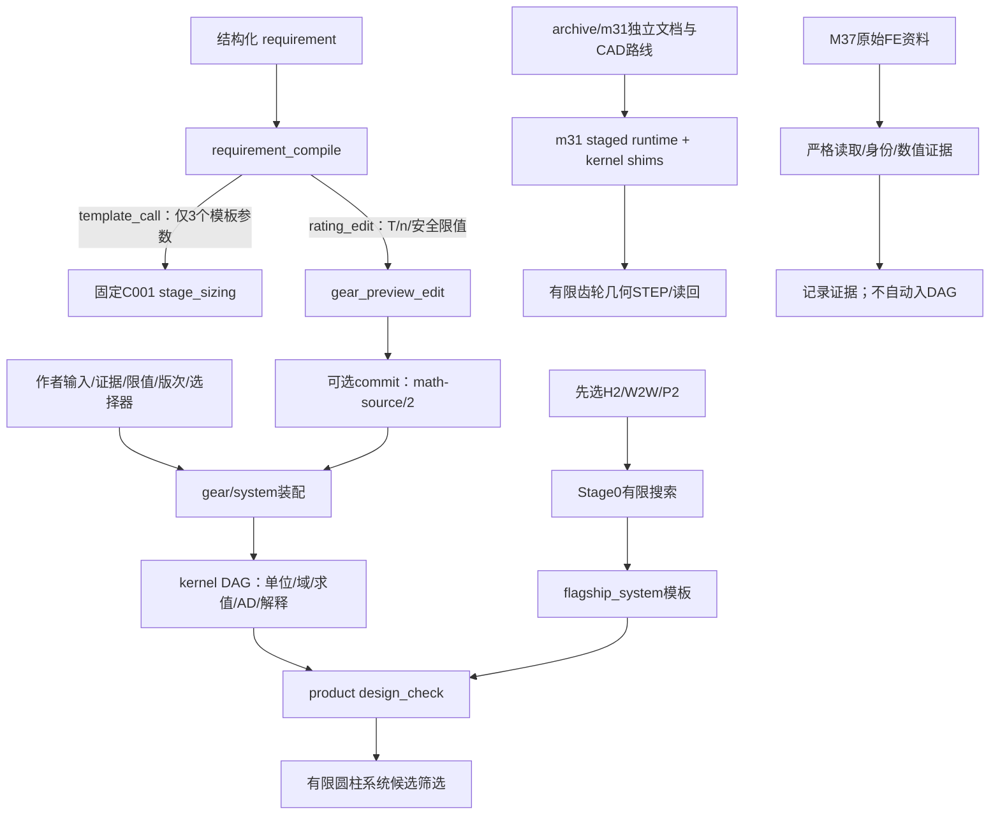

# gearbase v0.20 架构与实际可用性审计

审计对象：`D:/my_Works/Gears/gearbase-v020-work`，Git `80117283778cf8732b5557fa15c2e41f626f92fc`，`VERSION=0.20`。标准采用用户要求的完整产品目标，而不是以里程碑标签、工具数量或测试总数替代验收。审计时间为 2026-11-01；执行记录采用 UTC。

## Findings first

**当前可作为限定范围的数学计算与优化开发基座试用；尚不能作为“给出转速/扭矩/空间/轴关系，就自动完成全传动方案、FE/CAD和制造输出”的整系统产品验收。** 这不否定现有固定问题入口的可运行性；下面分别给出已运行的能力和实际缺口。

1. **ARC-01 / P1：新需求没有完整进入优化问题。** 当前实测把扭矩 40 改为 400 N·m、转速 1000 改为 3000 rpm，同时改变寿命、材料和空间上限，编译出的 `template_call`、Problem IR SHA 和完整 `optimize_nlp` 响应仍完全相同。第二份需求要求 `b≤5 mm`、`a≤20 mm`，返回的模板候选仍为 `b=21.300696 mm`、`a=57.120695 mm`、`feasible=true`。独立 `rating_edit` 分支的 `S_H1` 则从 0.941422 降到 0.297704。原因是模板内部继续调用固定 C001 工况；编译器已明确用 `unapplied`、`post_checks`、`applicability` 披露边界，因此这是**显式受限的产品路径，不能叫静默丢参或优化器误算**。证据：[intent.py:208](D:/my_Works/Gears/gearbase-v020-work/gearmath/tools/intent.py:208)、[problem.py:23](D:/my_Works/Gears/gearbase-v020-work/gearmath/gear/problem.py:23)、[原始响应](D:/my_Works/Gears/v020-freeze-assessment-2026-11-01/architecture/evidence/requirements.stdout.json)。

2. **ARC-02 / P1：多候选不等于自动拓扑规划。** 单级编译器拒绝 `stages=2 / gear_type=helical` 和 `axis_relation`；旗舰要求先指定 H2、W2W 或 P2；联合优化要求调用者提供有限的齿轮、轴、轴承候选轴。已实现的是固定问题参数搜索和候选排序，没有在当前 `gearmath` 主链找到依据轴关系/空间自动选择类型、级数及混合拓扑的规划器。证据：[intent.py:153](D:/my_Works/Gears/gearbase-v020-work/gearmath/tools/intent.py:153)、[flagship_workflow.py:9](D:/my_Works/Gears/gearbase-v020-work/gearmath/tools/flagship_workflow.py:9)、[system_optimize.py:129](D:/my_Works/Gears/gearbase-v020-work/gearmath/product/system_optimize.py:129)、[范围反例](D:/my_Works/Gears/v020-freeze-assessment-2026-11-01/architecture/evidence/requirements.stdout.json)。

3. **ARC-03 / P1：原始旗舰尚未形成可交付的系统级校核。** 当前 H2/W2W/P2 分别得到 40/15/5 个 Stage0 候选，但三者 `system_status=blocked`，模板缺项计数分别 93/62/61。W2W 与 P2 还明确缺全族强度和啮合力/均载分支。真实 C001 的单副强度通过，制造、胶合、微点蚀、轴、轴承、键和热检查仍阻断；K01 制造参数投影通过，其余请求检查阻断。这些 blocked 保留了真实缺项，不能用演示输入替代真实工程数据关门。证据：[flagship_system.py:1](D:/my_Works/Gears/gearbase-v020-work/gearmath/product/flagship_system.py:1)、[旗舰运行](D:/my_Works/Gears/v020-freeze-assessment-2026-11-01/architecture/evidence/flagships.stdout.json)、[统一校核运行](D:/my_Works/Gears/v020-freeze-assessment-2026-11-01/architecture/evidence/system.stdout.json)。

4. **ARC-04、ARC-05 / P1：数学图的真源闭环没有覆盖全部外部工件。** 作者源文档和 DAG 内更新已具备；本轮 b=30→33 的内存编辑使回执的 29 个数值变化，原始文档和外部证据分区保持不变。FE ingest 明确不把结果入图；归档 CAD 有独立源文档/装配/STEP 路线，当前新主链未找到同一 revision 驱动的 FE/CAD/供应商/图纸失效与重建协议。归档代码本身也把整箱体装配和制造图纸列为缺项；v0.20 M35 图只含直径包络和宽度审查准备。证据：[math_source.py:88](D:/my_Works/Gears/gearbase-v020-work/gearmath/gear/math_source.py:88)、[fea_ingest.py:1](D:/my_Works/Gears/gearbase-v020-work/gearmath/tools/fea_ingest.py:1)、[realize.py:170](D:/my_Works/Gears/gearbase-v020-work/archive/m31/src/gears/realize.py:170)、[m35_packet.py:23](D:/my_Works/Gears/gearbase-v020-work/gearmath/tools/m35_packet.py:23)。

完整的 8 项发现见 [findings.json](D:/my_Works/Gears/v020-freeze-assessment-2026-11-01/architecture/findings.json)，26 项独立能力及逐项限制见 [capability-matrix.json](D:/my_Works/Gears/v020-freeze-assessment-2026-11-01/architecture/capability-matrix.json)。其余发现记录真实客户端未验证、入口文档失真和身份权限界限，不能忽略。

## 当前实现的边界



图中两条需求输出确实不同：`rating_edit` 没有被 `stage_sizing_problem` 消费。归档 CAD 与 FE 证据路径存在，并不自动表示它们是现代数学真源的下游投影；本图没有补画未经证实的连接。

### 核心DAG与数学真源

`Model` 拒绝一个输出对应多条公式，也拒绝同时声明为输入和公式输出的量；输入检查单位、有限值和声明域。求值按依赖顺序进行，缺输入、版次和选择器会阻断；标准分册混版会被拒绝。每次求值从输入重建环境；这支持重算，但不等于全局工件依赖管理或任何外部数值都自动重新合格。[graph.py:132](D:/my_Works/Gears/gearbase-v020-work/gearmath/kernel/graph.py:132)、[graph.py:294](D:/my_Works/Gears/gearbase-v020-work/gearmath/kernel/graph.py:294)。

`gears.math-source/2` 存作者输入、证据、限值、选择器和版次；回执和参数表是只读投影。design_store 有所有权检查、修订链和可选文件持久化；本轮按只读约束只跑预览及内存副本投影，没有执行 commit、持久状态恢复或改写现有设计。[math_source.py:63](D:/my_Works/Gears/gearbase-v020-work/gearmath/gear/math_source.py:63)、[design_store.py:79](D:/my_Works/Gears/gearbase-v020-work/gearmath/tools/design_store.py:79)。

单位目录在 kernel 内提供 mm/N/s/rad/K 的规范量纲与边界换算，角度独立。系统模块和归档 CAD 还存在带显式单位约定的标量接口，因此不能把 kernel 的“唯一单位表”扩大解释为所有遗留/供应商路径已经共享同一个跨域 Quantity 类型。[units.py:1](D:/my_Works/Gears/gearbase-v020-work/gearmath/kernel/units.py:1)、[shaft_beam.py:18](D:/my_Works/Gears/gearbase-v020-work/gearmath/system/shaft_beam.py:18)。

### 系统校核、梁与优化

统一 `design_check` 请求范围包含 gear_rating、manufacturing、scuffing、micropitting、shaft、bearing、key、fit、thermal；计算状态与证据资格分别报告。返回外层 `status=ok` 只表示工具调用成功，必须继续读 `result.computation` 和各 scope 的 `status/missing/unconfirmed`。[design_check_tool.py:31](D:/my_Works/Gears/gearbase-v020-work/gearmath/tools/design_check_tool.py:31)、[design_check.py:912](D:/my_Works/Gears/gearbase-v020-work/gearmath/product/design_check.py:912)。

多支承直轴梁实现 Euler–Bernoulli/Timoshenko，显式支承、分段圆截面、集中/均布载荷、E/G、节点挠度/转角和扭转积分；不包括轴承/箱体弹性、临界转速等。`beam_face.face_components` 计算有限轴贡献，要求外部扭转位移来源并承认 gear_body/housing/bearing_compliance/wheel 缺项，明确不是完整 ISO `f_sh/KHβ`。已有 KHβ 公式与这一有限贡献函数，不能合称整系统自动双向反馈闭环。[shaft_beam.py:1](D:/my_Works/Gears/gearbase-v020-work/gearmath/system/shaft_beam.py:1)、[beam_face.py:7](D:/my_Works/Gears/gearbase-v020-work/gearmath/gear/beam_face.py:7)。

当前有限联合搜索确实有可用价值：每个候选以 fresh design_check context 检查，按完全相同输入身份缓存，目标为齿坯与轴体积；在本轮固定 27 组合中，8 个可行，17 次 design_check，4 次缓存命中，与重新独立遍历这27组合的结果相同。独立的是搜索遍历路径，**物理检查器和目标仍共用**，不是外部物理认证。最佳候选 ID 为 `original / economy / original`，目标体积 `206968.12401849555 mm³`。这份输入是明确标注的 capability fixture，不是真实 C001 设计数据。[system_closure.py:12](D:/my_Works/Gears/gearbase-v020-work/gearmath/tools/system_closure.py:12)、[原始结果](D:/my_Works/Gears/v020-freeze-assessment-2026-11-01/architecture/evidence/system.stdout.json)。

### Gear families：公式/候选/产品分开

| 族或部件 | 当前可见实现与本轮证据 | 阻断边界 |
|---|---|---|
| 外啮合直齿 | C001副校核当前pass；固定单级优化可运行 | 任意新需求尚未完整接入模板；不是整箱体完成 |
| 外啮合斜齿 | 公式含beta，K系列装配路径；H2 Stage0当前40候选 | 本轮未全量复跑helical对标；H2全系统blocked |
| 内齿、双斜齿 | `internal_gear.py`、`double_helical.py`和TR30特定构造分支 | 有公式不等于通用行星均载、承载与制造闭环；本轮未执行这些专用分支 |
| 蜗杆W2W | Stage0当前15候选，包含恒摩擦效率/给定对流热初筛 | 首选热项要求更改；无蜗杆强度/磨损/胶合及三向载荷全系统评级 |
| 行星P2 | Stage0当前5候选，整数几何/配装/运动学/Pareto | 无行星排均载/浮动件载荷与全系统强度 |
| 锥齿、齿条、交错轴斜齿等 | archive/vendor有局部类型/生成资产 | 当前gearmath需求→规划→评级→CAD整链未找到，不把文件存在算主链支持 |
| 轴承、轴、键、过盈 | 显式参数的ISO281/DIN743/DIN6892/DIN7190；有限联合fixture实跑 | 真实旗舰缺来源数据；不自动补全供应商型号/支承/箱体 |
| 箱体、丝杆/螺母 | 热模型可接受显式散热参数；归档有部分几何机制 | 当前主链未找到完整箱体设计/装配与power screw/nut校核入口 |

相关限定证据：[internal_gear.py:1](D:/my_Works/Gears/gearbase-v020-work/gearmath/gear/internal_gear.py:1)、[double_helical.py:1](D:/my_Works/Gears/gearbase-v020-work/gearmath/gear/double_helical.py:1)、[flagship_workflow.py:35](D:/my_Works/Gears/gearbase-v020-work/gearmath/tools/flagship_workflow.py:35)、[family_workflow.py:1](D:/my_Works/Gears/gearbase-v020-work/archive/m31/src/gears/integration/family_workflow.py:1)。

### CAD/装配/图纸与FE

归档 runtime 通过 staged tree 和 kernel-backed shims 恢复原 M31 入口，不等于把全部归档实现迁为现代 `gearmath` 主链。归档四族 headless 工作流包含 source→job→STEP、读回与文件身份；齿轮 STEP 的 inspected geometry 可以存在，整产品装配仍明确缺轴、轴承、箱体、行星架和完整制造图纸。本审计没有启动CAD或重新验证这些原生输出。[m31_runtime.py:243](D:/my_Works/Gears/gearbase-v020-work/gearmath/tools/m31_runtime.py:243)、[gear_native.py:144](D:/my_Works/Gears/gearbase-v020-work/archive/m31/src/cadbench/gear_native.py:144)、[realize.py:170](D:/my_Works/Gears/gearbase-v020-work/archive/m31/src/gears/realize.py:170)。

受审 tooth_authority 限定零变位，斜齿提供工作渐开线面并明确不提供完整滚切齿根或CAD/FE全等资格。v0.20 M35 准备包有用，但 `geometry_scope=diameter envelopes only; no tooth profile`、`manufacturing_release=false`；不能把审查准备输出当制造完成。[tooth_authority.py:1](D:/my_Works/Gears/gearbase-v020-work/archive/m31/src/cadbench/tooth_authority.py:1)、[m35_packet.py:97](D:/my_Works/Gears/gearbase-v020-work/gearmath/tools/m35_packet.py:97)。

M37准备/严格读取/入库路径在核心工具中可见，带输入、求解器、覆盖与运行身份约束；`fea_ingest`明确结果只记录、不进入公式图。这里只确认代码边界，没有重跑FE，也没有据旧证据提升任何FE门状态。详细FE物理与门审计应引用对应专项结果。[fea_prepare.py:33](D:/my_Works/Gears/gearbase-v020-work/gearmath/tools/fea_prepare.py:33)、[fea_ingest.py:71](D:/my_Works/Gears/gearbase-v020-work/gearmath/tools/fea_ingest.py:71)。

## 当前会话运行证据

全部运行使用 `python -X utf8 -B`；产品源码树的 `git status --porcelain` 前后均为空。探针只写 stdout；捕获器只把结果写入本审计目录。没有安装依赖，没有执行GUI/鼠标/新FE，没有commit或改数据/金标/门状态。

| Smoke | 现有入口 | 实际结果 | 原始证据 |
|---|---|---|---|
| S1 MCP/计算/编辑预览 | `mcp_server.py` stdio | initialize/list/resources/prompts/rate/preview/get/explain正常；宽度编辑改变4项强度值且不保存；派生量/错单位输入阻断 | [mcp.stdout.json](D:/my_Works/Gears/v020-freeze-assessment-2026-11-01/architecture/evidence/mcp.stdout.json) |
| S2需求/模板反例 | `ai_tools.call(requirement_compile/optimize_nlp/gear_rate)` | 改T/n/寿命/材料/空间后优化不变，rating分支改变；超出级数/轴字段明确阻断 | [requirements.stdout.json](D:/my_Works/Gears/v020-freeze-assessment-2026-11-01/architecture/evidence/requirements.stdout.json) |
| S3旗舰 | `flagship_workflow.run`、`flagship_system.solve_family` | 三族Stage0有候选，完整系统全部blocked；W2W保留热失败 | [flagships.stdout.json](D:/my_Works/Gears/v020-freeze-assessment-2026-11-01/architecture/evidence/flagships.stdout.json) |
| S4统一系统/有限优化/真源投影 | `design_check`、`system_closure.report`、`math_source.project_receipt` | 缺输入如实blocked；27组合/8可行与fresh遍历一致；b编辑改变29数值，原源文档不变 | [system.stdout.json](D:/my_Works/Gears/v020-freeze-assessment-2026-11-01/architecture/evidence/system.stdout.json) |

四组探针退出码均0，指探针成功验证上述限定行为，**不表示每个工程检查都pass**。每组约0.4–1.5秒；完整命令、退出码与stdout SHA在 [commands.json](D:/my_Works/Gears/v020-freeze-assessment-2026-11-01/architecture/evidence/commands.json)。随后为可复制配方又按同样入口的精确CLI拼写运行单副校核及联合closure，两者退出0：[cli-commands.json](D:/my_Works/Gears/v020-freeze-assessment-2026-11-01/architecture/evidence/cli-commands.json)。

本机解释器是 `D:/anaconda3/python.exe` / Python 3.12.4。仅检查distribution metadata：SciPy、cadquery/OCP、gmsh存在，pymoo、build123d、npTDMS未检出；这不是原生导入成功证明，也不证明别的已配置CAD解释器缺能力。四组主链smoke不依赖这些可选包。[environment-inventory.json](D:/my_Works/Gears/v020-freeze-assessment-2026-11-01/architecture/evidence/environment-inventory.json)。

## 当前可复制试用入口

以下PowerShell命令从冻结包根运行。前两种数值配方已在本轮执行；MCP持久状态示例**只给命令，不执行、不创建状态目录**。

### 单副数值校核、解释与只读预览

```powershell
Set-Location -LiteralPath 'D:\my_Works\Gears\gearbase-v020-work'
python -X utf8 -B -c "import json; from gearmath.tools.ai_tools import call; print(json.dumps(call('gear_rate',{}),ensure_ascii=False,indent=2))"
```

这是现有 C001_G1 基线，当前返回pass。替换实际设计前，应先给完整 source 文档和方法/材料/载荷证据；只改T/n也可以stateless评级，但基线中其余证据值不会自动成为新设计的合格证据。`gear_explain`和`gear_preview_edit`的实际请求见S1原始JSON，预览不提交。

### 固定圆柱系统的有限多方案筛选

```powershell
Set-Location -LiteralPath 'D:\my_Works\Gears\gearbase-v020-work'
python -X utf8 -B -m gearmath.tools.system_closure --inputs data/system-optimization/v017-capability-probe.json --out 'D:\my_Works\Gears\v020-freeze-assessment-2026-11-01\architecture\evidence\joint-cli'
```

真实CLI读取已存在的作者capability fixture，输出27组合、8可行以及closure证据，只写上述审计目录。其价值是验证**已显式给定**的齿轮、轴/键、轴承候选组合；目标排除了轴承包络/价格、箱体和轴挠度到KHβ反馈。不是从自然语言自动生成整箱体设计，也不是真实C001全部输入补齐。

### stdio MCP服务器

```powershell
python -X utf8 -B -I 'D:\my_Works\Gears\gearbase-v020-work\mcp_server.py'
```

服务器等待逐行JSON-RPC，不是图形界面。默认设计状态仅在该进程内存。无状态工具、预览与解释的精确请求/响应已经保存在S1。连接客户端时应把该可执行文件和参数数组交给客户端；本轮证明的是本地协议往返。

如用户自行需要持久设计状态，可使用以下真实参数入口；本轮没有执行：

```powershell
python -X utf8 -B -I 'D:\my_Works\Gears\gearbase-v020-work\mcp_server.py' --state-dir 'D:\my_Works\Gears\gearbase-user-state'
```

写入仍由对应commit工具触发；仅启动时会初始化指定状态目录。这是未来用户主动运行的示例，未改动冻结包或用户项目配置。

### 重放本审计配方

```powershell
Set-Location -LiteralPath 'D:\my_Works\Gears\gearbase-v020-work'
python -X utf8 -B 'D:\my_Works\Gears\v020-freeze-assessment-2026-11-01\architecture\run_smokes.py'
```

探针固定校验基线HEAD，输出只覆盖自身architecture/evidence中的审计捕获文件。`smoke_readonly.py requirements`含需求反例的全部输入和原始响应；`flagships`可直接试用已有三族Stage0及系统缺项。原M31回归入口 `python -X utf8 -B -m gearmath.tools.m31_regression --json`确实存在，但本轮未运行；它会在临时staged tree运行原测试及其CAD/FE依赖路线，不能当本轮只读smoke之一或无成本快速试用命令。[m31_regression.py:35](D:/my_Works/Gears/gearbase-v020-work/gearmath/tools/m31_regression.py:35)。

## MCP、身份和审批的边界

当前stdio服务器实际自报 `gearmath-prototype / version=0.5`，而包为0.20；根README仍自称v0.11和665 tests，接入文档列13工具而实际默认17工具。根README“legacy不可运行”不能解释为整个历史能力完全不可恢复：新的实际入口针对的是 `archive/m31` staged tree，而非证明 `legacy/` 目录可直接运行。建议下一包统一入口与版本来源，本轮没有修改这些文件。[README.md:1](D:/my_Works/Gears/gearbase-v020-work/README.md:1)、[ai_tools.py:628](D:/my_Works/Gears/gearbase-v020-work/gearmath/tools/ai_tools.py:628)。

历史文档记录过Claude Code连接成功但模型请求HTTP403、没有模型发起tools/call；本轮没有重试该账户，不能由旧日志断言当前仍失败，也不能用确定性MCP客户端替代真实自然语言端到端验收。[M38-closure.md:42](D:/my_Works/Gears/gearbase-v020-work/docs/M38-closure.md:42)。

`gear_commit` 的token/CAS/版本校验保证请求与基线一致，**不认证用户身份或人工审批**。`provenance=user/evidence/...`是调用者可填写的分类，标签本身不证明谁输入、证据真实性或工程批准；`confirm=true`同样来自调用参数。`optimize_and_commit`的列出开关控制工具发现，call分发不受它影响，所以不能把“默认不列出”作为权限边界。宿主客户端授权/审批与工程签署若需要，应在外层显式实现并绑定源修订。本项是接口语义界限，未证明远程利用或越权，也没有进行攻击实验。[ai_tools.py:405](D:/my_Works/Gears/gearbase-v020-work/gearmath/tools/ai_tools.py:405)、[ai_tools.py:536](D:/my_Works/Gears/gearbase-v020-work/gearmath/tools/ai_tools.py:536)、[optimize_commit.py:1](D:/my_Works/Gears/gearbase-v020-work/gearmath/tools/optimize_commit.py:1)。

## 最重要的三项瓶颈与实际可用工作流

1. **需求没有成为同一份可计算设计真源。** 下一受控产品切片可列P0：让 full_requirement→source-owned sizing→rating使用同一载荷/限值/空间约束，材料/寿命无证据就阻断。本轮反例应保留为需求验收回归。先闭合这条窄路径，比把更多工具挂到不连贯的需求输出更可验收。
2. **方案生成停留在调用者预选的类型与拓扑。** 当前能在H2/W2W/P2或显式候选轴内选方案；用户目标中的轴关系、类型、级数与混合传动规划仍缺通用主链。后续应有明确topology IR、分级传动比与可制造/适用域约束，独立于单副尺寸优化验收。
3. **真实系统输入及跨域投影闭环尚未到交付程度。** 从一个有来源的圆柱系统样例开始，补齐轴/轴承/连接/热数据，建立revision到CAD/FE/制造输出的失效与重建证据；再逐族扩展。当前缺项、FE不入图、归档CAD边界和制造准备hold均应保留，不能用演示数据或旧工件存在替代。

实际可用顺序为：**先用单副数值校核/解释/预览检查输入与公式链；对预选拓扑运行Stage0取初选并读缺项；在完全显式的圆柱候选集上做有限联合筛选；已有声明源文档再走source-owned优化/重建验证。** CAD与FE目前需要另走各自受限工作流和资格证据，尚不能承诺自然语言一键完成全产品。

## Where This Review May Be Wrong

- 对“没有通用拓扑规划/丝杆螺母主链”的判断来自当前 `gearmath`模块、公开schema和调用入口；同名外部项目、未装插件或别名实现可能不在本包。若要推翻，应提供能从用户轴关系/速度/扭矩约束执行到候选及校核结果的当前调用链，而不是仅提供类型枚举或源文件。
- CAD、梁、TR30内齿/双斜齿及真实AI客户端未在本轮执行；本审计只对代码范围和已保存文档作定位，不据此断言它们必然不能运行。可在另一个获准的验证轮次用已配置原生解释器/真实客户端运行既有入口，并保留revision与读回证据。
- 联合搜索的fresh对照独立重建上下文与组合遍历，但仍共用design_check和体积公式；需求反例也限定在当前单级模板和一个离散组合。它能证明接口不传递新载荷/空间，不能证明所有优化路径失效或代替外部标准物理交叉验证。
